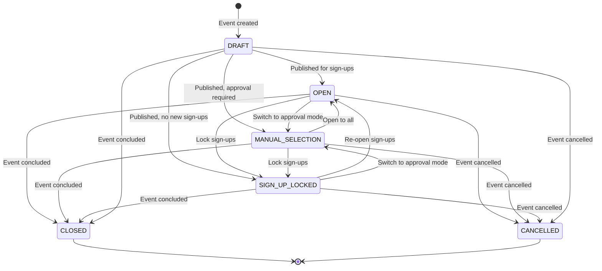
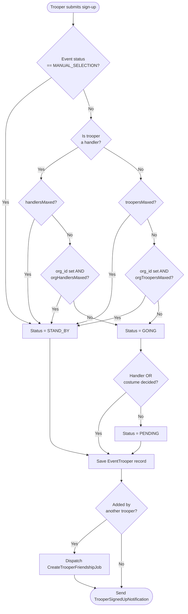
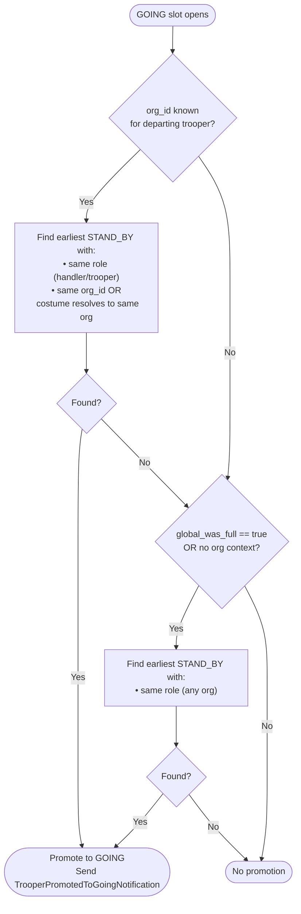

# Events

## Event Types

Event types are rows in `tt_event_types` that system owners and staff officers manage under **Command Staff → Event Types** (`/admin/event-types`). Each type has:

| Setting | Column | Effect |
|---|---|---|
| Name | `name` | Shown in the event form's Event Type list and on reports |
| Description | `description` | Shown under the Event Type list once the type is picked |
| Order | `sort_order` | Drag-sorted; the event form lists types in this order and preselects the first for new events |
| Counts toward troop totals | `is_counted` | When off, attending doesn't add to troop totals, and every place members see the event says so (see below) |
| Offered on the event form | `is_active` | When off, new events can't pick it; events that already use it keep it |

Each event points at its type with `tt_events.event_type_id` (foreign key to `tt_event_types.id`), so renaming a type is safe. A type can only be deleted while no event uses it; otherwise hide it. An event created without a type gets the first offered one (`EventType::defaultId()`, set in `EventObserver`), as the form preselects it.

The `2026_11_08_000001_create_event_types_table` migration seeds the twelve former enum values, all counted and offered: Regular first (it was the preselected type before), then the rest alphabetically as the form listed them. It then replaces each event's old `type` string with the matching `event_type_id`. Nothing else changes until a system owner or staff officer edits them.

### Types that don't count

A type with `is_counted = false` is left out of everything that counts a trooper's troops: the shift count, rank and troop milestones (`RecalculateTrooperRank`, overall and per club), the service record's per-club troop counts, the leaderboard's top troopers and costume leaderboards, the trooper event summary report, the public API's trooper history (`troopCount`), and the troop history the HoloNet plugin shares. Volunteer hours and charity totals still include these events, and they still appear in a trooper's history.

Members are told the same way everywhere, so nobody finds out after the fact. `Event::notCountedNotice()` is the one sentence ("Non-troop-credit event: Does not count toward troop totals.") and the event resources send it to the Svelte pages that show it:

| Where | What shows |
|---|---|
| Event list card | Info icon in the header in place of the unit logo (an at-risk event keeps its warning icon), the sentence above the address |
| Calendar | Info icon after the name, the sentence as its tooltip |
| Event page | Info icon in the title bar in place of the unit logo, the sentence at the top of the details and again above the roster |
| Service record history | "Non-troop-credit" pill next to the event (card and table views), so the history matches the totals |
| Forum thread post (XenForo plugin) | The sentence in bold under the title and venue |
| Discord announcement | The sentence on its own line under "… has been posted." |

The header keeps its status color (open, at risk, locked): its icon is white like the at-risk warning, the service record's pill is white on dark so it reads on every theme, and the notice borrows only its left edge from the theme's info color, since some themes' info color is close to the locked header's.

Queries use `Event::counted()` / `EventTrooper::counted()`, or `whereNotIn('tt_events.event_type_id', EventType::query()->uncountedIds())` in raw joins. Because counts are worked out when queried, changing a type's setting applies to its past events too: leaderboards change right away, the stored shift count at the nightly `tracker:calculate-trooper-achievements` run. Milestones already awarded are not taken back.

**Source:** `app/Models/EventType.php`, `app/Messages/EventTypes/`

### One troop per day (optional)

Some garrisons count a day at an event as one troop, however many shifts a trooper works that day. Set `TRACKER_COUNT_AS_ONE_TROOP_PER_DAY=true` to turn it on. Then, when a trooper attends more than one shift of the same event on the same day, the earliest of those shifts counts and the others don't. Volunteer hours and charity still count for every shift, and every shift stays in the trooper's history. Shifts on other days and shifts at other events are unaffected. It applies to every shift, past ones included, so an existing event with two shifts on a day loses a troop for each trooper who attended both. Off (the default), every shift counts, as before.

"Same day" is the date the shift starts as the tracker shows it (`APP_TIMEZONE`). The troop goes to the clubs credited on the earliest shift. For the sign-up messages, "on a shift" means going, tentative, stand-by, pending a costume or attended (`Event::isOnShift()`).

It applies wherever troops are counted: `EventTrooper::counted()` leaves the extra shifts out (`OneTroopPerDay::excludeRepeats()`), so the shift count, rank and troop milestones, the leaderboards, the public API's `troopCount` and the HoloNet troop history follow it, and the service record's per-club counts use the same rule on the loaded shifts (`OneTroopPerDay::repeatIds()`). The trooper event summary report's "Total Shifts" still counts every shift.

**Importing from TT1.0.** TT1.0 counted every linked event as its own troop. So while the rule is on, a linked event whose main event's group already has a shift that day at a different time is imported (`LegacyEventGroups`) as an event of its own instead of a shift. Imported troops then come out the same as in TT1.0. Turn the rule on before the import.

Members hear about it before they sign up, not after:

| Where | What shows |
|---|---|
| Event page | On an event with more than one shift on a day: "One troop per day: more than one shift on the same day counts as one troop.", with a line saying two shifts add one troop and hours and charity still count, at the top of the details and again above the roster |
| A shift on the same day as one you're on | A warning beside its Sign Up button: you're already signed up for (time) on (day); this shift won't add another troop |
| Signing up for it anyway | A message as the sign-up saves: this counts as one troop for the day, and how many shifts that day they're signed up for |
| Shifts you're on, on the same day | On each: you're also signed up for (time); together these shifts count as one troop |
| Forum thread post (XenForo plugin) and Discord announcement | The same sentence, where an event that doesn't count shows its notice (`Event::troopCreditNotice()`) |
| Service record history | "Same day, counted once" pill on each shift that didn't add a troop |

**Source:** `app/Support/OneTroopPerDay.php`, `resources/svelte/pages/events/components/display/SameDayNote.svelte`

---

## Event Coordinator

The event page shows an "Event Coordinator" under the Point of Contact box, linked to their service record. It's whoever created the event (`created_id`) unless someone else is picked, since the person who makes an event isn't always the one who runs it.

Anyone who can edit the event picks the coordinator on its Overview tab (`coordinator_trooper_id`), before or after the event. The choices are active event coordinators and up (command staff's rule; members, handlers and visitors can't be picked) who are going to or attended on any of its shifts, including attendance waiting for a moderator to verify (`Event::COORDINATOR_STATUSES`). Each reads "Legal Name (username)". Leaving it empty means the creator. If the picked trooper's sign-ups stop qualifying (a status change, a removed sign-up or a removed shift), the field goes back to empty and the creator shows again (`Event::releaseIneligibleCoordinators()`, from the sign-up and shift observers). It's a quiet update: no notifications or forum edits.

The picked coordinator can edit and run that event even when someone else created it or it's outside their moderator scope: details, shifts, charity, roster, photos and mission review (`Event::managedBy()`, so `EventPolicy::update`). It shows in their **My Events**. They can't move the event to an organization they can't host for, so the Overview shows its host as plain text. Losing the pick (someone else is picked, or their sign-up stops qualifying) or the role ends the access.

Picking a coordinator doesn't change who created the event, so the forum thread stays under the creator's name.

**Source:** `app/Models/Event.php` (`eventCoordinator()`, `coordinatorCandidates()`), `app/Models/Scopes/HasEventScopes.php` (`scopeManagedBy()`), `routes/web/admin-events.php`, `resources/svelte/pages/events/components/display/ContactSection.svelte`, `resources/svelte/pages/admin/events/components/EventFields.svelte`, `resources/svelte/pages/admin/events/components/OverviewTab.svelte`

---

## Holidays on the Calendar

Events → Calendar shows holidays in their day cells, under the date and above that day's events, so coordinators and troopers can see at a glance when a request falls on a holiday weekend. They're labels only: not events, not filtered, not in the ICS feed.

`GetHolidays::call(from:, to:)` returns the names by date, from the [Yasumi](https://www.yasumi.dev) library. `TRACKER_CALENDAR_HOLIDAYS` (`tracker.calendar.holidays`) names the Yasumi provider: `USA`, the default, is the US federal holidays; any other country or region Yasumi knows works too (`Canada`, `UnitedKingdom/Scotland`, ...), and `none` turns them off. Yasumi's "observed" weekday copies of weekend holidays are left out, so each holiday shows once, on its own date. An unknown provider shows no holidays and is reported to the log rather than breaking the page.

**On phones** (below 768px) the calendar isn't a grid: seven columns leave about 45px a day, too narrow to read an event name, so each month lists only the days that have an event or holiday showing, as "Thu 26" followed by its holidays and events. Days from the neighbouring months are left out (that month lists them), and so are days whose events the search or filters hide. It's CSS only (`.event-calendar` in `resources/css/app.scss`); the page and its filters are the same at every width.

**Source:** `app/Messages/Events/Queries/GetHolidays.php`, `resources/svelte/pages/events/Calendar.svelte`

---

## Event Status Lifecycle

An event moves through statuses as it progresses from creation to completion.



### Status Descriptions

| Status | DB Value | `is_open` | `is_active` | Description |
|---|---|---|---|---|
| `DRAFT` | `draft` | No | Yes | Created but not yet visible for sign-ups |
| `OPEN` | `open` | Yes | Yes | Accepting sign-ups normally |
| `MANUAL_SELECTION` | `manualselection` | Yes | Yes | Sign-ups land as STAND_BY; admin approves each one |
| `SIGN_UP_LOCKED` | `locked` | No | Yes | No new sign-ups; existing roster unchanged |
| `CLOSED` | `closed` | No | No | Event has concluded |
| `CANCELLED` | `cancelled` | No | No | Event was cancelled |

### Side Effects on Transition

| Transition | Side Effects |
|---|---|
| DRAFT → OPEN / MANUAL_SELECTION / SIGN_UP_LOCKED | All shifts updated to match new status; `SendEventCreatedNotificationsJob` dispatched |
| Any → CANCELLED | All shifts set to CANCELLED; all active `EventTrooper` records set to CANCELLED; `SendEventCancelledNotificationsJob` dispatched |
| Capacity limits changed | `ReconcileEventRosterJob` dispatched to re-evaluate the roster |

**Source:** `app/Http/Controllers/Admin/Events/Commands/UpdateEventController.php`

---

## Signup Flow

When a trooper signs up for a shift, the system determines whether they are assigned **GOING** (confirmed) or **STAND_BY** (waiting).



A costume decision means the trooper either picked a real costume or explicitly selected "attending without a costume" from the costume dropdown — see [Costume Decision Requirement](#costume-decision-requirement). The initial sign-up form itself never collects a costume; `PENDING` troopers make this decision afterward from their roster row.

**Source:** `app/Messages/Events/Commands/SignUpEventTrooper.php`

### Sign-up tour

Signing up has no form or Submit button: Sign Up adds the trooper as `PENDING`, and the costume, status and Made It / Missed It all save from their own roster row. The event page's "How sign-up works" tour shows where each of those happens, on dashed example rows above the real shifts (nothing in them works, and nothing in the tour signs anyone up). It dims the page around each step's target and walks through: signing up for each shift (or opening a collapsed one), the mission brief first when it must be acknowledged, picking a costume, the optional backup costume, changing plans, adding a friend or guest, and saying whether they made it. A step whose target isn't on the page is left out.

The **How sign-up works** button above the roster replays it at any time. `TRACKER_SIGNUP_TOUR` decides who it also starts for by itself, on an event with a shift open for sign-up:

| Value | Starts by itself for |
|---|---|
| `new_troopers` (default) | troopers with no attended sign-up yet (`ATTENDED` or `AWAITING_VERIFICATION`, any event type) |
| `everyone` | every trooper, for example while a garrison moves over from another tracker |
| `off` | nobody; the button still works |

Once a trooper finishes or closes it, the browser remembers (localStorage, per trooper), so it doesn't start by itself again on that browser. There's nothing stored on the server, so a new phone or a cleared browser shows it once more.

**Source:** `app/Support/SignUpTour.php`, `resources/svelte/pages/events/components/display/SignUpTour.svelte`, `resources/svelte/pages/events/models/vms/SignUpTourViewModel.svelte.ts`

---

## Standby Promotion Flow

When a confirmed (GOING) slot opens — due to cancellation, a role switch, or a reconcile run — the system promotes the next eligible STAND_BY trooper.



**Org priority:** When a trooper held an org-limited slot, the system first offers that slot to the next STAND_BY from the same org (by `organization_id` or by costume org inference). Only if no same-org STAND_BY exists — or if global capacity was also full — does it consider troopers from any org.

**Costume decision required:** A `STAND_BY` candidate is only eligible for promotion if they're a handler or have already decided on a costume (`EventTrooper::needsCostumeBeforeGoing()` is `false`). Candidates who haven't made that decision are skipped in favor of the next eligible candidate in the same pool — they remain on `STAND_BY` and can be promoted later once they decide, or picked up by a subsequent promotion run.

**Source:** `app/Messages/Events/Commands/PromoteNextInLineEventTrooper.php`

---

## Trooper Attendance Status

Once signed up, a trooper's attendance is tracked by `EventTrooperStatus`.

| Status | DB Value | Set By | Meaning |
|---|---|---|---|
| `NONE` | `none` | System | Default; no status assigned |
| `GOING` | `going` | System / Trooper | Confirmed attendance |
| `STAND_BY` | `standby` | System | Waitlisted; promoted when a slot opens |
| `TENTATIVE` | `tentative` | Trooper | Trooper is unsure; only available on non-limited events |
| `PENDING` | `pending` | System | Signed up, but a non-handler trooper hasn't yet decided on a costume — see [Costume Decision Requirement](#costume-decision-requirement) |
| `ATTENDED` | `attended` | Admin | Trooper showed up and attended |
| `CANCELLED` | `cancelled` | Trooper / System | Trooper withdrew or event was cancelled |
| `NOT_PICKED` | `notpicked` | Admin | Not selected for a limited/manual-selection event |
| `NO_SHOW` | `noshow` | Admin | Confirmed GOING but did not appear |
| `UNABLE_TO_ATTEND` | `unabletoattend` | Admin | Could not attend for external reasons |

**Source:** `app/Enums/EventTrooperStatus.php`

---

## Costume Decision Requirement

A non-handler trooper cannot hold `GOING` status until they've decided on a costume. Handlers (`is_handler = true`, from a handler-type costume or the trooper's membership role) are exempt and skip this entirely.

`EventTrooper::needsCostumeBeforeGoing()` is the single rule:

```php
return !$this->is_handler && $this->costume_id === null && !$this->attending_without_costume;
```

A costume decision is one of two mutually exclusive choices, made from the costume dropdown on the trooper's roster row:

- Pick a real costume (`costume_id` set, `attending_without_costume = false`).
- Select "Attending without a costume" from the dropdown (`costume_id = null`, `attending_without_costume = true`) — for roles that are legitimately costume-less without being a Handler-type costume.

Leaving both undecided is what keeps (or puts) a trooper on `PENDING` instead of `GOING`.

**Where it's enforced:**

| Path | Behavior |
|---|---|
| Initial sign-up (`SignUpEventTrooper`) | Would-be `GOING` is downgraded to `PENDING` when undecided. Capacity-driven `STAND_BY` is unaffected. |
| Status change / manual-selection approval (`UpdateTrooperSignUpController`, `status` branch) | Requesting `GOING` while undecided is silently saved as `PENDING` instead. |
| Re-sign-up (`UpdateTrooperSignUpController`, `resign_up` branch) | Same downgrade as initial sign-up. |
| Stand-by promotion (`PromoteNextInLineEventTrooper`) | Undecided candidates are skipped — see [Standby Promotion Flow](#standby-promotion-flow). |
| Costume dropdown submit (`UpdateTrooperSignUpController`, `costume_id` branch, via `resolveCostumeDecision()`) | Deciding while `PENDING` promotes to `GOING` (or `STAND_BY` if capacity is now full); clearing the decision while `GOING` demotes back to `PENDING`. |

**UI:** The costume `<select>` in `resources/svelte/pages/events/components/display/RowEditor.svelte` includes a `none` sentinel option ("Attending without a costume") ahead of the real costume list. A `PENDING` trooper sees a hint prompting them to make a choice instead of the normal status dropdown.

**Source:** `app/Models/EventTrooper.php` (`needsCostumeBeforeGoing()`), `app/Http/Controllers/Events/Commands/UpdateTrooperSignUpController.php` (`resolveCostumeDecision()`), `database/migrations/2026_07_24_160615_add_attending_without_costume_to_event_troopers_table.php`

---

## Capacity Enforcement

Capacity is enforced at two levels. Both are checked on every sign-up.

### Global Limits (per event)

Stored on the `events` table:

| Column | Controls |
|---|---|
| `troopers_allowed` | Max total troopers per shift |
| `handlers_allowed` | Max total handlers per shift |
| `shifts_allowed` | Max shifts a single trooper can join on this event |
| `friends_allowed` | Max friends a trooper can add to a shift |
| `guests_allowed` | Max guests a trooper can add to a shift |

`NULL` means unlimited.

### Per-Organization Limits

Stored on the `event_organizations` table (one row per org invited to the event):

| Column | Controls |
|---|---|
| `troopers_allowed` | Max troopers from this org per shift |
| `handlers_allowed` | Max handlers from this org per shift |

`NULL` means no per-org cap for that role.

### Reconciliation

When an admin changes capacity limits on an active event, `ReconcileEventRosterJob` is dispatched. It re-evaluates every GOING and STAND_BY trooper on each shift, sorted by `signed_up_at` (earliest first), and promotes or demotes as needed to match the new limits. Affected troopers receive an email notification.

**Source:** `app/Jobs/ReconcileEventRosterJob.php`, `app/Models/EventShift.php`

---

## Notification Summary

| Trigger | Notification |
|---|---|
| Trooper signs up | `TrooperSignedUpNotification` |
| STAND_BY promoted to GOING (cancellation/role change) | `TrooperPromotedToGoingNotification` |
| Admin approves a STAND_BY (MANUAL_SELECTION event) | `ManualSelectionApprovedNotification` |
| Admin demotes a trooper (MANUAL_SELECTION event) | `ManualSelectionStandByNotification` |
| Event transitions from DRAFT to any open state | `SendEventCreatedNotificationsJob` |
| Event cancelled | `SendEventCancelledNotificationsJob` |
| Reconcile promotes a trooper | `TrooperNextInLine` email |
| Reconcile demotes a trooper | `TrooperManualSelectionStandBy` email |
| Daily digest | `DailyEventNotification` |

---

## Shift Structure

Each event contains one or more **shifts** (`EventShift`). Troopers sign up for individual shifts, not the event itself. Capacity limits are enforced per shift.

```
Event
└── EventShift (e.g., "Morning", "Afternoon")
    └── EventTrooper (one per trooper per shift)
```

When an event's status changes, all of its shifts are updated to match. Shift-level capacity checks happen inside `EventShift::troopersMaxed()`, `handlersMaxed()`, and `orgTroopersMaxed()`.

**Source:** `app/Models/EventShift.php:145-215`
